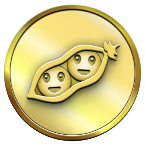

# 🏆 GitHub Trophy Sentinel

Hệ thống tự động cày và nâng cấp các huy hiệu GitHub Achievements (Pull Shark, Galaxy Brain, Quickdraw, YOLO, Pair Extraordinaire...) lên cấp Vàng, đi kèm Web Dashboard trực quan và Live Terminal Stream thời gian thực.

Repo này giúp bạn tự động hóa toàn bộ quy trình tạo PR, tự động merge, thảo luận Discussions Q&A hợp lệ theo đúng cơ chế của GitHub mà không tốn công sức làm thủ công.

---

## ⚡ 3 bước cài đặt & chạy ngay

### 1. Tải source code về máy
```bash
git clone https://github.com/tanbaycu/github-badge.git
cd github-badge
npm install
npm run build
```

### 2. Cấu hình Token GitHub
Bạn có thể cấu hình bằng 1 trong 2 cách:

* **Cách 1 (Khuyên dùng)**: Chạy Web UI, hệ thống có sẵn màn hình **Setup Wizard** để bạn dán token trực tiếp, web sẽ tự lưu vào file `.env`.
* **Cách 2**: Sao chép file `.env.example` thành `.env` rồi điền thủ công:
  ```bash
  cp .env.example .env
  ```
  Nội dung file `.env`:
  ```env
  # Token tài khoản chính (nhận huy hiệu)
  GITHUB_TOKEN=ghp_xxxxxxxxxxxxxxxxxxxxxxxxxxxx

  # Token nick phụ để hỏi & accept Galaxy Brain (Tùy chọn, cách nhau bằng dấu | nếu có nhiều nick)
  HELPER_GITHUB_TOKEN=ghp_clone1|ghp_clone2

  # Repo dùng để cày (nếu chưa có tool sẽ tự tạo public repo này)
  TARGET_REPO=github-trophy-vault

  # Cổng chạy web dashboard
  PORT=3456
  ```

> **Lưu ý về quyền Token (PAT Classic):**
> Khi tạo token tại [GitHub Personal Access Tokens](https://github.com/settings/tokens), bạn chỉ cần tích chọn 3 quyền:
> - `repo` (Thao tác repository, PRs, commits)
> - `write:discussion` (Tạo và trả lời Discussions)
> - `workflow` (Tùy chọn)

---

### 3. Khởi động Web Dashboard
```bash
npm start
```
Mở trình duyệt truy cập: **`http://localhost:3456`**

* **Cockpit điều khiển**: Chỉnh hạn ngạch số lượng PR (2, 16, 128...) và bấm Start để cày ngay trên web.
* **Live Terminal Stream**: Màn hình terminal thời gian thực hiển thị từng bước commit, merge PR qua Server-Sent Events (SSE).
* **Trophy Vault**: Xem danh sách huy hiệu chính thức đã sở hữu và các mốc tier tiếp theo cần đạt.

---

## 💻 Hoặc chạy trực tiếp bằng dòng lệnh (CLI)

Nếu bạn không muốn mở trình duyệt, có thể chạy trực tiếp từ Terminal:

```bash
# 1. Quét trạng thái các huy hiệu hiện tại của tài khoản
npm run hunt:recon

# 2. Cày Pull Shark (Merge PRs lên cấp Vàng)
npm run hunt:shark

# 3. Cày Galaxy Brain (Tự động hỏi - đáp Q&A trong Discussions)
npm run hunt:galaxy

# 4. Săn huy hiệu ăn liền: Quickdraw (< 5s) và YOLO (merge không review)
npm run hunt:quickdraw
npm run hunt:yolo

# 5. Săn Pair Extraordinaire (Co-authored commit)
npm run hunt:pair

# 6. Săn TOÀN BỘ huy hiệu cùng lúc
npm run hunt:max
```

---

## 🎯 Danh sách các huy hiệu hỗ trợ

| Huy hiệu | Tên huy hiệu | Yêu cầu GitHub | Cách tool tự động xử lý |
| :---: | :--- | :--- | :--- |
|  | **Pull Shark**<br>*(Cấp Vàng / Bạc)* | Merge 2 / 16 / 128 / 1024 PRs | Tự động tạo nhánh, commit ledger và auto-merge an toàn vào `main`. |
|  | **Galaxy Brain**<br>*(Cấp Vàng x4)* | 2 / 8 / 16 / 32 câu trả lời được Accept | Chu trình Dual-Token: Nick phụ hỏi $\rightarrow$ Nick chính trả lời $\rightarrow$ Nick phụ bấm Accept. |
|  | **Quickdraw** | Đóng Issue hoặc PR trong < 5 phút | Tự động mở Issue và close ngay tức thì trong vòng 2 giây. |
|  | **YOLO** | Merge PR mà không qua review | Mở PR trên nhánh phụ và merge thẳng mà không cần code review. |
|  | **Pair Extraordinaire** | Đồng tác giả trong 1 PR | Gắn thẻ `Co-authored-by` vào commit message và merge PR. |
|  | **Starstruck**<br>*(Cấp Vàng)* | Repo đạt 16 / 128 / 512 Stars | Hỗ trợ điều phối tương tác repo và cộng đồng nhận Star. |

---

## 🛡️ Cơ chế an toàn (Anti-Abuse)
* **Request Pacing**: Giãn cách tự động 1.5s - 2.5s giữa các request để không vi phạm `Secondary Rate Limit` của GitHub.
* **Dọn dẹp tự động**: Nhánh tạm sau khi merge xong sẽ được xóa gọn gàng để giữ repo sạch đẹp.
* **Bảo mật tuyệt đối**: File `.env` chứa token cá nhân được khai báo trong `.gitignore`, không bao giờ bị đẩy lên GitHub.

---

## 📝 License
Phát hành theo giấy phép MIT. Dự án phục vụ mục đích học tập và tối ưu quy trình làm việc với GitHub API.
Made with ❤️ by [tanbaycu](https://github.com/tanbaycu).
